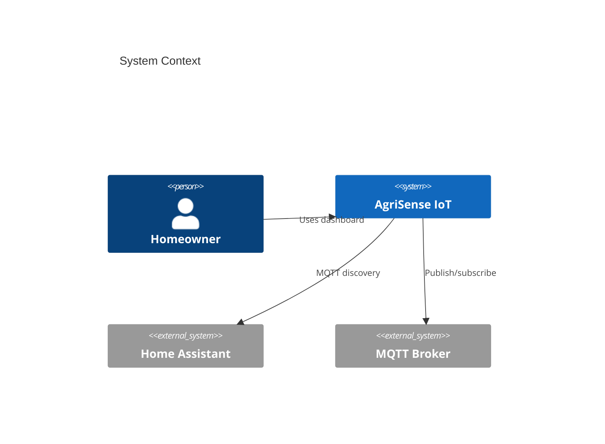
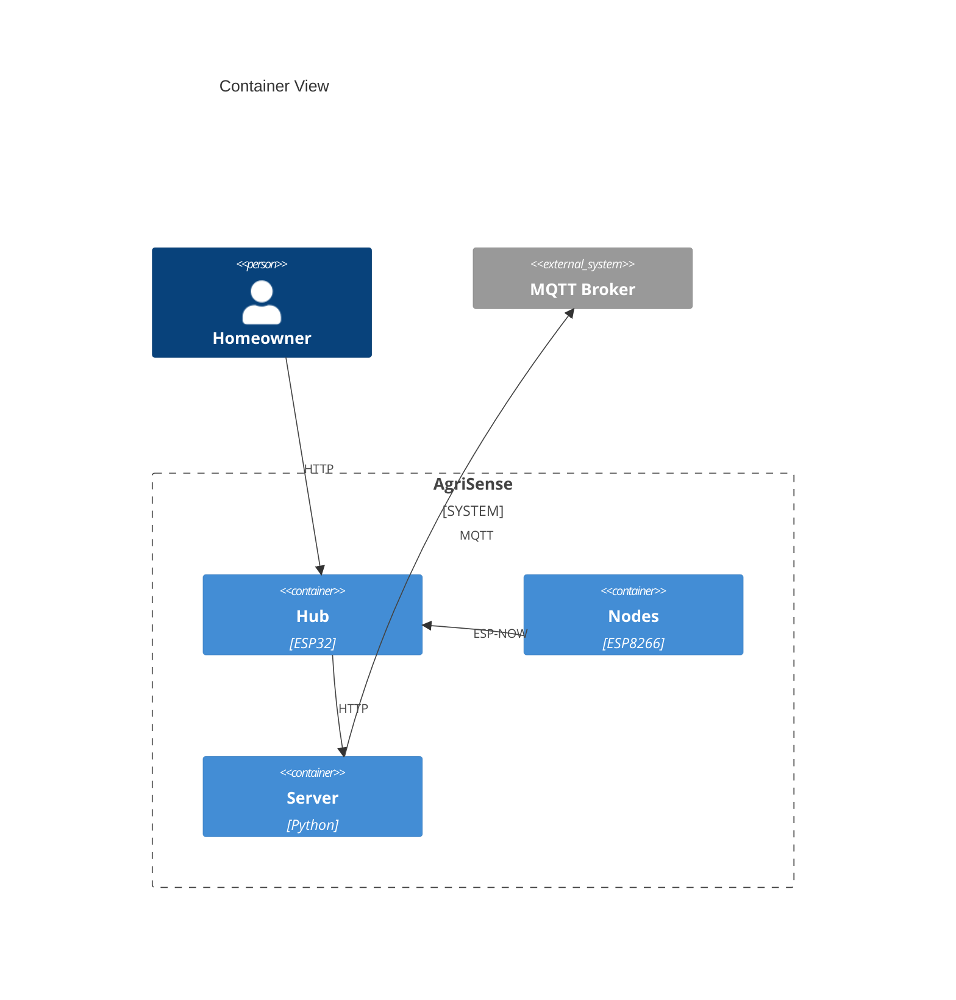
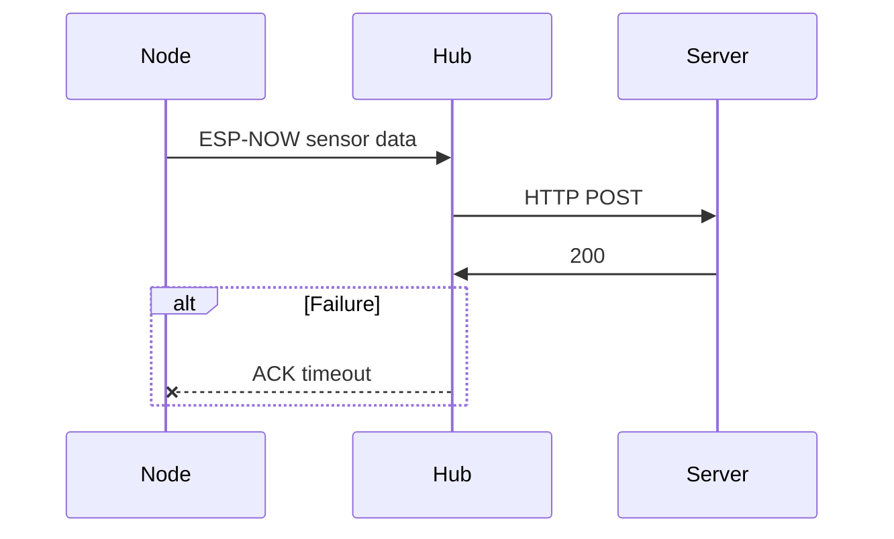
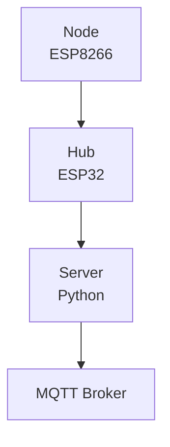

# Software Architecture Document: AgriSense IoT

## Purpose and Scope

AgriSense IoT is a local-first home automation platform: battery and mains-powered ESP nodes communicate via ESP-NOW to a central ESP hub, which bridges state/commands to a Python server and Home Assistant over HTTP/MQTT.

## Technical Context

**Language/Version**: C++17 (ESP8266/ESP32), Python 3.10+ 
**Primary Dependencies**: PlatformIO, Arduino framework, WiFiManager, PubSubClient, ArduinoJson 
**Storage**: EEPROM (nodes), NVS (hub), SQLite/JSON (server) 
**Testing**: manual bench testing; no automated unit tests 
**Target Platform**: ESP8266/ESP32 devices, Linux server (Docker) 
**Project Type**: polyglot embedded platform 
**Performance Goals**: hub loop non-blocking; deep sleep wake < 240s 
**Constraints**: ESP memory limits; same AP/channel for ESP-NOW 
**Scale/Scope**: single home, one hub, many nodes

## System Decomposition

| Boundary | Responsibilities | Data Ownership | Exposed Interfaces | Dependencies | Deployment Independence |
|----------|------------------|----------------|--------------------|--------------|-------------------------|
| Hub | Bridge ESP-NOW↔HTTP/MQTT, registry, dashboard | virtual_sensor_t (NVS) | HTTP, MQTT, ESP-NOW | Server, shared | Independent |
| Nodes | Sense/actuate, ESP-NOW send/receive | EEPROM config | ESP-NOW, HTTP (TCP nodes) | Hub, shared | Independent |
| Server | HA integration, MQTT discovery, REST | device registry | HTTP REST, MQTT | Hub | Independent |
| Shared | Protocol, WiFi, common utilities | N/A | library | all | submodule |

## System Scope and Context

Actors: homeowner, integrator. External: Home Assistant, MQTT broker, router/AP. Trust boundary: LAN only.

### C4 System Context

### C4 Container View

## Architecture View Catalog

| View | Concern | Scope | Notation | Rationale |
|------|---------|-------|----------|-----------|
| System Context | Actors/externals | Whole | C4 Context | Required |
| Container View | Runtime/data | Whole | C4 Container | Required |

## Solution Strategy and Architecture Style

- **Architecture Style**: Event-driven embedded platform (ESP-NOW + MQTT)
- **Source Code Layout**: existing layout (hub/, nodes/, server/, shared/)
- **Why this style fits**: low power, local-first, offline capable
- **Alternatives considered**: cloud IoT (rejected: power/connectivity)

## Major Data Flow Catalog

| Flow ID | Trigger | Source / Actor | Processing Boundaries | Stores | Egress | Trust / Data Class | Consistency / Transaction | Failure / Recovery | Diagram |
|---------|---------|----------------|-----------------------|--------|--------|--------------------|---------------------------|--------------------|---------|
| FLOW-001 | Node wake | Node | ESP-NOW → Hub → Server | NVS | MQTT | LAN | eventual | retry/timeout | FLOW-001 |

## Major Data Flow Diagrams

### FLOW-001: Node Telemetry

## Additional Architecture Views

None.

## Deployment and Trust Topology

LAN-only; single region.

## Cross-Cutting Concerns

### Security
LAN trust; no auth on local dashboard (assumed trusted network).

### Reliability
Watchdog on hub; retry on nodes.

### Observability
Serial/telnet console, Telegram alerts.

### Data Management
EEPROM/NVS persistence; server DB.

### Integration Strategy
ESP-NOW, HTTP REST, MQTT discovery.

### Operations
Manual flash/OTA; Docker server.

## Quality Attributes

| Attribute | Target | Measurement | Architectural Response |
|-----------|--------|-------------|------------------------|
| Performance | loop < 10ms per iteration | profiler | millis state machines |
| Reliability | 99.5% uptime | monitoring | watchdog + retry |
| Maintainability | 4 boundaries max | review | shared submodule |

## Architecture Traceability

| Capability / Objective | Boundary | Major Flow | Quality Target | ADRs |
|------------------------|----------|------------|----------------|------|
| CAP-001 | Hub | FLOW-001 | Reliability | N/A |
| CAP-002 | Nodes | FLOW-001 | Performance | N/A |

## Architecture Decision Records

| ADR ID | Title | Status | Date | Supersedes | File |
|--------|-------|--------|------|------------|------|

<!-- Rows are managed by the ADR Author subagent. -->

## Risks, Assumptions, Constraints, and Open Questions

### Risks
- Hub intermittent crash (open root cause)

### Assumptions
- Single hub per network

### Constraints
- ESP memory limits

### Open Questions
- Dual power mode for acquiry-bat

## Project Context Baseline Updates

- Initial SAD (draft)